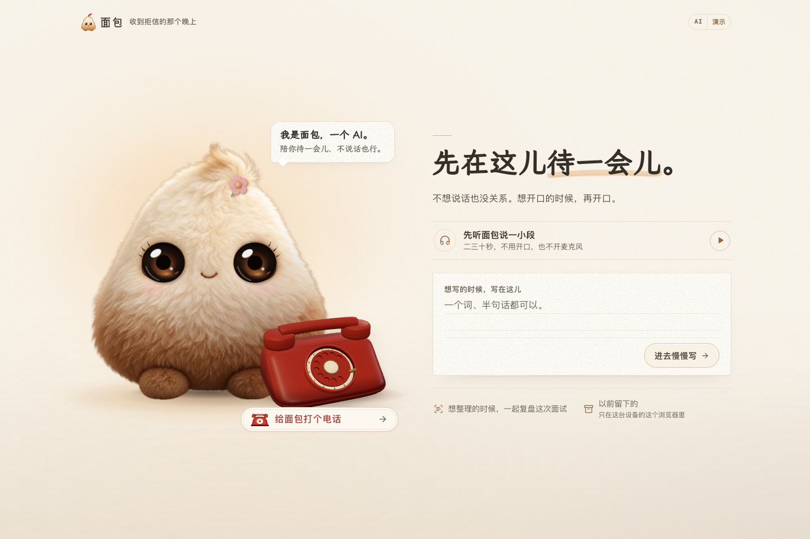

# Bread · 面包

**A warm companion for a difficult evening. Complexity belongs to the agent.**

After an interview rejection, stay for a moment without having to explain. When you feel ready, turn your own material into an editable note or practice one question.

The core flow is low-effort expression → voluntary review → one grounded next step. Natural-language review, rejection-aware regeneration, optional redo directions and persistent edit labels keep control with the user. Contested analysis receives a bounded consistency check and can fall back to quotations and unknowns; ordinary chat has no extra call.

[Task acceptance and actual synthetic outputs](evaluations/task-control/README.md) include failed iterations and quality limits. Formative observation with 3–5 real participants is still pending.

[Try online](https://bread.163-7-7-42.sslip.io) · [中文](README.md) · [Product & harness](docs/product-harness.md) · [Competitive comparison](docs/competitive-benchmark.md) · [Roadmap](ROADMAP.md) · [Contributing](CONTRIBUTING.md)

[](https://github.com/ZJUZhiyuCai/bread-companion/actions/workflows/ci.yml)
[](LICENSE)



## What works

- A warm paper room with self-hosted WenKai typography, a quiet listen strip, ruled notepaper and light matte controls. Connection recovery makes room for the page, while saving and leaving remain visible before a long final card. [Frontend relay and verification](docs/frontend-relay-validation.md).

- An original plush character with steady, fully open glass eyes, a muted felt flower, fine embroidered lashes and soft blush. Speech gently parts the original stitched smile; highlights and touch responses remain subtle. Rest, pause and error keep the eyes open; reduced-motion preferences are respected.
- A Blender-built, Three.js-rendered rotary phone with lacquer-red surfaces, an ivory dial and brass details. It dials and lifts its handset with the real connection state; a bundled opening uses the configured default voice.
- A quiet entry: listen/read first, enter with an empty note, and review only when ready. No greeting hop or forced microphone access.
- Chinese text conversations and continuous browser voice calls, with speech interruption, mute, pause and hangup.
- Agent-led notes, interview review and one-question practice without setup forms.
- Evidence-linked, editable cards. Correcting a source invalidates old references.
- Explicit save preview, browser-local storage, Markdown/JSON export and JSON import.
- Bounded context, in-session preferences, timeouts, deduplication, cancellation and retry without duplicate messages.

**Version 0.4.0 preview, available locally and as an HTTPS online trial.** Both deployments use signed anonymous visit cookies and shared admission budgets: SQLite on the primary Node host, D1 on the Worker backup. Chats and saved cards remain browser-local. There are no accounts, cross-device sync or persistent relationship memories; the trial is capacity-limited, not an availability guarantee. See [deployment](docs/deployment.md), [data handling](docs/data-handling.md) and [hosting dependency review](docs/hosting-dependencies.md). Calls use ASR → text generation → TTS. On the primary host, one response delivers the validated text and then its complete MP3, avoiding a separate browser synthesis request. It is not a native full-duplex speech model.

## Run without API keys

Use the Node version in `.nvmrc` (`nvm use` is optional if it is already installed).

```sh
git clone https://github.com/ZJUZhiyuCai/bread-companion.git
cd bread-companion
nvm use
npm ci
cp .env.example .env.local
npm run dev
```

Open **http://127.0.0.1:3210**. Default Mock mode is visibly labeled and supports the text/card/practice flow; voice requires configured providers. Keep an existing `.env.local` if you already have one. Build a local production instance with `npm run build && npm start`.

Text companionship and calls use DeepSeek Flash with thinking disabled and a focused empathy prompt; analysis retains the same Wanjie DeepSeek route. The hosted deployments call HTTPS providers directly. For real services, see [Setup](docs/setup.md). Speech remains MiniMax ASR / Speech 2.8 HD with `Chinese (Mandarin)_Warm_Bestie`. Route IDs are provider-specific. Keys stay server-side; never put them in `NEXT_PUBLIC_*`.

The home telephone keeps the same appearance throughout loading: a matching model still stays visible until the first 3D frame is painted, and remains callable if graphics fail. The call scene uses an animated SVG fallback. See the [model source and rebuild guide](docs/phone-model.md); running Bread does not require Blender.

## Evidence, not an EQ badge

235 unit/integration checks and 53 browser paths cover cancellation, evidence, storage, calls, the opening/animation lifecycle and stationary-pointer regressions. The v14 synthetic Chinese suite completed 16/16 API responses, with a **1.165 s median complete-response latency**. One goodbye used an application rule, not an LLM call. Both before/after outputs remain public: formulaic language, unsupported detail and unsolicited advice still occur.

A local production test with a virtual microphone started the bundled opening in **240 ms**. Two real-provider turns took **4.202 / 3.275 s** from end of input to audio, with **362 ms** speech interruption latency. The opening uses bundled audio; subsequent replies need live synthesis. These small samples are not a latency guarantee. Physical microphones, Bluetooth and real mobile devices remain unverified.

On November 2, the primary public host's three-turn median fell from **9.475 to 5.108 s**, measured from the end of the same synthetic utterance to browser playback start. One new turn still took **10.412 s**; three additional diagnostic turns took **5.062–5.801 s**. A real-provider interruption recovered in **419 ms** and completed the next turn. These are desktop Chrome AudioWorklet tests at a mobile viewport, not physical-phone measurements. The [latency report and raw results](docs/call-latency.md) retain the slow sample and distinguish browser timing from HTTP timing.

```sh
npm run typecheck
npm run check:models
npm test
npm run build
npx playwright install chromium
CI=true BREAD_E2E_PORT=3213 npm run test:e2e
npm run eval:companion -- --dry-run
```

CI uses Mock providers. Live evaluation is opt-in and may incur provider costs:

```sh
npm run eval:companion -- --live --app http://127.0.0.1:3210
```

See the [synthetic cases and published outputs](evaluations/README.md), [current entry, 3D phone and adversarial validation](docs/phone3d-audit.md), [earlier voice validation](docs/living-companion-validation.md), and [sourced competitor comparison](docs/competitive-benchmark.md). The comparison is public-source research plus Bread testing, not a blinded trial of paid competitor products.

Two hosted synthetic rounds took **7.89 / 9.12 s** for the combined ASR, text and TTS HTTP requests; this is not browser time-to-first-audio. The slower final-framework result is published alongside the first sample. These public measurements should not be confused with the faster local measurements above.

Current shared-budget, concurrency and deployment evidence is in [0.4.0 validation](docs/craft-online-validation.md). Bundled greeting preparation overlaps microphone permission; local archive loading overlaps capability discovery. Paid generation is never hedged across duplicate requests.

## Architecture and participation

`domain/` owns state and validation; `services/` owns session/media/storage lifecycles; `server/` and `app/api/` own provider calls and request boundaries; `prompts/` owns versioned instructions. `deployment/sites/` contains the Worker adapter, shared admission migration and reproducible staging script. The model proposes content. The application controls permissions, cancellation and saving.

[Documentation](docs/README.md) · [Contribution guide](CONTRIBUTING.md) · [Security](SECURITY.md) · [Code of conduct](CODE_OF_CONDUCT.md) · [Changelog](CHANGELOG.md)

Official Claude Code and DeepSeek contributed frontend design refinements; Codex implemented and verified backend integration, under the maintainer's direction. Original hashes and integration notes are retained in the provenance documents.

**[MIT](LICENSE)** © 2026 Zhiyu Cai and Bread contributors. See [character/audio provenance and image prompt](docs/living-companion-assets.md) and [Third-party notices](THIRD_PARTY_NOTICES.md) for asset and dependency scope.

The self-hosted Bread Voice subsets are derived from LXGW WenKai Screen under **SIL OFL 1.1**, separately from the software MIT license. See [font source and rebuild](docs/fonts.md).

The first hosted synthetic chain measured complete HTTP requests of **3.597 s ASR / 2.415 s text / 1.873 s TTS**. This is slower than the earlier local sample and does not include browser endpointing or playback setup; it is not a hosted first-audio guarantee.

Mobile microphone recovery and the model latency comparison are documented in the [mobile call validation](docs/mobile-call-validation.md) (Chinese).
