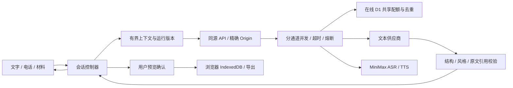

# 面包 · Bread

**把复杂留给 agent，把温暖留给用户。**

收到拒信的那个晚上，可以先在这儿待一会儿。想开口时再聊；想复盘时，再把真实材料整理成一张卡片、练一道题。

[在线体验](https://bread-companion-czy.rosscai.chatgpt.site) · [English](README.en.md) · [快速开始](#快速开始) · [产品与 Harness](docs/product-harness.md) · [竞品对标](docs/competitive-benchmark.md) · [路线图](ROADMAP.md) · [参与贡献](CONTRIBUTING.md)

[](https://github.com/ZJUZhiyuCai/bread-companion/actions/workflows/ci.yml)
[](LICENSE)


*实际运行界面。在线版由维护者配置服务；本地无密钥启动仍清楚标为规则演示。*

## 它能做什么

- **灯下的一张小桌子。** 自托管文楷、便笺横格、黄铜播放器、珐琅电话铭牌与胶木通话键；纸纹和光影保持静态，手机与夜间模式沿用同一套材质。

- **一个会回应的小伙伴。** 照片版毛绒身体、始终完整睁开的玻璃眼睛，能回应摸头；高光轻缓变化，减少动态时保持安静。
- **拿起红色 3D 电话。** Blender 建模、Three.js 渲染；漆红机身、象牙转盘与黄铜细节；点座机即可拨号，接通后听筒抬起，传来温暖闺蜜的声音，默认开场从本地播放。
- **可以先安静地待着。** 首页不催促表达；先读一小段话、选择播放，或空着便笺进入聊天，复盘放到后面。
- **直接开口或打字。** 不填情绪标签，不先选模式；面包用简短中文回应。
- **自然插话。** 网页电话按停顿接话；面包在想或在说时可以直接开口打断，也能静音、暂停、挂断。
- **想整理时再整理。** 贴材料、留个记号、看回答、练一题；题目与关注点由 agent 准备。
- **每个判断能回到原话。** 卡片可以改、删、否认和重做；原话纠正后旧引用失效。
- **保存由你决定。** 卡片预览确认后才写入当前浏览器，支持 Markdown / JSON 导出和 JSON 导入。
- **失败有退路。** 原话旁重试不重复发话；超时、停止、结束和迟到结果由控制器处理。

这是 **0.4.0 预览版**，支持本地运行与 HTTPS 在线体验。在线版不用填写模型配置；浏览器会自动取得短期匿名访客凭据，聊天和已保存卡片仍留在当前浏览器。共享并发与滚动配额用于控制公开体验成本，达到上限会暂时拒绝新请求，不承诺全天可用。没有账号、云同步或跨天关系记忆。见 [部署与限额](docs/deployment.md)、[数据处理](docs/data-handling.md) 和 [我们与领先产品的差距](docs/competitive-benchmark.md)。

## 快速开始

建议使用 [.nvmrc](.nvmrc) 中的 Node.js 版本；已安装对应 Node 时可跳过 `nvm use`。

```sh
git clone https://github.com/ZJUZhiyuCai/bread-companion.git
cd bread-companion
nvm use
npm ci
cp .env.example .env.local
npm run dev
```

打开 **http://127.0.0.1:3210**。默认 Mock 无需账号和密钥，能体验文字、材料、卡片与练习流程；它是固定规则演示。已有 `.env.local` 时保留自己的配置。

生产模式：

```sh
npm run build
npm start
```

macOS 也可以双击 `启动面包.command`。它只在本机启动应用。在线部署使用独立的 Sites / Cloudflare Worker 适配，见 [部署指南](docs/deployment.md)。

### 接入真实文字与语音

3D 电话加载或 WebGL 失败时自动回到可拨号的 SVG；[模型源码与重建](docs/phone-model.md) 不要求运行应用的人安装 Blender。

配置都在服务端，用户不需要填写模型表单。完整变量与步骤见 [配置指南](docs/setup.md)。

| 能力 | 当前验证过的配置 |
| --- | --- |
| 文字 / 电话回复 / 复盘 | 本机 Magpie 路由 `wanjie/deepseek-v4.1-flash-1017`；在线版直连同一万界方舟上游 `deepseek-v4.1-flash-1017`，Anthropic 兼容协议 |
| 语音转写 | MiniMax `asr-1.0` |
| 语音合成 | MiniMax `speech-2.8-hd`，`Chinese (Mandarin)_Warm_Bestie` |

这些是维护者已测路由，不是所有服务商都通用的模型 ID。也可按适配器协议配置自己的接入服务。密钥只放 `.env.local`，不要放进 `NEXT_PUBLIC_*`。

## 如何判断它真的好用

我们公开测试口径和失败样本，不把请求成功当作“情商通过”。

| 检查 | 已有证据 |
| --- | --- |
| 工程回归 | 174 项单元/集成、42 条浏览器流程；CI 跑类型、模型资产检查、测试、构建与 Chromium |
| 本轮公网语音链路 | 单回合 ASR **3.597 s**、模型 **2.415 s**、TTS **1.873 s**；是完整 HTTP 请求，尚未测公网浏览器首响 |
| 中文对话复测 | v14：8 个情境、16 轮接口调用，含一条控制层道别；完整响应中位 **1.165 s**、p90 **1.477 s**；未测首 token |
| 语音链路 | v0.2 虚拟麦克风实测：固定开场 **0.240 s**；两轮说完至回复出声 **4.202 / 3.275 s**；开口至停止旧声 **362 ms** |
| 仍然会失败的体验 | 明确道别已有窄范围规则；仍有套话、补写细节和未请求的建议。调参前后原始合成样本全部保留 |

样本量小、环境特定，以上不是 SLA 或跨产品排名。物理麦克风、外放、蓝牙和手机真机仍待测。本轮公共运行时与并发证据见 [0.4.0 对抗验收](docs/craft-online-validation.md)。此前体验详见 [开场、3D 电话与功能验收](docs/phone3d-audit.md)、[此前语音验收](docs/living-companion-validation.md)、[对话评估](evaluations/README.md) 和 [竞品对标](docs/competitive-benchmark.md)。

```sh
npm run typecheck
npm run check:models
npm test
npm run build
npx playwright install chromium
CI=true BREAD_E2E_PORT=3213 npm run test:e2e
```

正常测试不调用付费模型。单独进行真实对话评估：

```sh
npm run eval:companion -- --dry-run
# 以下命令会调用你配置的真实服务，可能产生费用
npm run eval:companion -- --live --app http://127.0.0.1:3210
```

## 架构



模型产出内容候选；确认、存储、权限、超时和取消由应用控制。固定欢迎语读取与麦克风准备并行，本地存档与能力检查并行；付费模型请求不会做竞速式重复调用。语音回复仍按 ASR → 文本 → TTS 顺序，尚不是流式语音模型。

| 目录 | 职责 |
| --- | --- |
| `domain/` | 类型、校验、reducer、来源版本与原文证据 |
| `services/` | 会话与媒体生命周期、存档事务、导出 |
| `server/`、`app/api/` | 供应商适配、同源边界、限流、截止时间与去重 |
| `deployment/sites/` | 在线 Worker 适配、D1 迁移与可复现的独立发布目录生成器 |
| `prompts/` | 有版本的倾听、分析与电话提示词 |
| `components/`、`app/` | Claude 与 DeepSeek 协作的界面、面包形象与电话 |
| `tests/`、`evaluations/` | 工程回归、合成情境和可复现的评估记录 |

[完整文档导航](docs/README.md) · [数据处理](docs/data-handling.md) · [安全策略](SECURITY.md) · [更新记录](CHANGELOG.md)

## 贡献与许可

欢迎从中文对话失败案例、真机语音复现、可控记忆或文档入手。先看 [贡献指南](CONTRIBUTING.md)、[路线图](ROADMAP.md) 和 [社区约定](CODE_OF_CONDUCT.md)。

前端由官方 Claude Code 与 DeepSeek 协作打磨，Codex 负责后端、集成与验证，维护者负责项目取舍；原稿哈希与接入差异保留在设计溯源中。

**[MIT License](LICENSE)** © 2026 Zhiyu Cai and Bread contributors。角色与语音来源见 [素材说明与生成提示词](docs/living-companion-assets.md)，[自托管字体](docs/fonts.md) 遵循 SIL OFL 1.1；依赖及素材权利范围见 [Third-party notices](THIRD_PARTY_NOTICES.md)。
