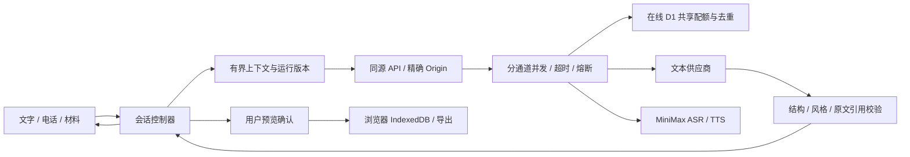

# 面包 · Bread

**把复杂留给 agent，把温暖留给用户。**

收到拒信的那个晚上，你可能只想把话说出来，还没有力气分析哪里出了问题。面包是一个中文陪伴与轻复盘工具：先陪你聊，等你愿意了，再一起看看那段回答。

[在线体验](https://bread-companion-czy.rosscai.chatgpt.site) · [English](README.en.md) · [快速开始](#快速开始) · [产品与 Harness](docs/product-harness.md) · [竞品对标](docs/competitive-benchmark.md) · [路线图](ROADMAP.md) · [参与贡献](CONTRIBUTING.md)

[](https://github.com/ZJUZhiyuCai/bread-companion/actions/workflows/ci.yml)
[](LICENSE)


*实际运行界面。可以直接在线体验，也可以在本地用无需密钥的规则演示开始。*

## 先聊聊，想整理时再继续

### 1. 先把想说的话说出来

不用填情绪标签、上传完整简历或选择模型。半句话也可以开始，暂时不想听建议也可以直接说。你可以打字，或拿起桌上的红色电话，用说话的方式和面包聊。通话时可以直接开口打断，也能静音、暂停或挂断。

### 2. 愿意复盘时，看看一段具体的回答

告诉面包“我现在想复盘一下”，再贴上当时的回答或你记得的片段。它会整理出一张**复盘卡**，把你提供的内容、可能的解释、目前不知道的事和可练习的方向分开。拒信没有说出的原因，仍然是未知。

需要依据的判断可以展开查看原话。不认同时，可以点“我不这么看”，让面包撤回这条判断后重新整理；也可以补充想换的方向，或直接改写卡片。如果你更正了原始材料，引用旧内容的卡片会提示需要重做。你补写的内容会单独标出，原来的引用不会自动成为新内容的依据。

### 3. 想继续的话，只练一个小地方

点“练一题”，面包会根据已有材料准备一道题和关注点。你回答后，再看看哪些部分已经说清楚、哪里还可以具体一点。不需要为了完成流程而练习，也可以随时停在前一步。

卡片是否留下，由你决定。保存前会展示具体内容和保存位置；确认后，它才会留在当前浏览器里。你也可以修改、删除，或导出为 Markdown / JSON 文件。

[用虚构材料走一遍三分钟体验](docs/demo.md) · [阅读完整产品设计](docs/product-harness.md)

## 在线体验与版本边界

当前是 **0.4.0 预览版**。

- **在线无需配置。** 打开 [面包](https://bread-companion-czy.rosscai.chatgpt.site) 就能开始，模型和语音服务由维护者配置。
- **存档留在当前浏览器。** 没有账号、云同步或跨天关系记忆。真实模式下，回复所需的文字和语音片段会发送给配置的处理服务；“本机保存”不等于“内容从不离开设备”。具体范围见 [数据处理说明](docs/data-handling.md)。
- **公开体验有配额。** 为控制服务成本，站点限制同时处理的请求和一段时间内的使用量。达到上限会暂时无法发起新请求，当前不承诺全天可用。见 [部署与限额](docs/deployment.md)。

## 快速开始

想在自己的电脑上运行，建议使用 [.nvmrc](.nvmrc) 中的 Node.js 版本；已经安装对应版本时可跳过 `nvm use`。

```sh
git clone https://github.com/ZJUZhiyuCai/bread-companion.git
cd bread-companion
nvm use
npm ci
cp .env.example .env.local
npm run dev
```

打开 **http://127.0.0.1:3210**。默认的 Mock 模式不需要账号和密钥，可以体验文字、材料、卡片与练习流程；它使用固定规则，不能代表真实模型的理解能力。如果已有 `.env.local`，请保留自己的配置。

生产模式使用 `npm run build` 后运行 `npm start`。macOS 也可以双击 `启动面包.command`，在本机启动应用。在线部署使用 Sites / Cloudflare Worker 适配，步骤见 [部署指南](docs/deployment.md)。

### 接入真实文字与语音

在服务端 `.env.local` 中配置服务地址、模型和 API Key，使用者不需要在页面上填写这些信息。完整变量与示例见 [配置指南](docs/setup.md)。

| 能力 | 维护者已验证的配置 |
| --- | --- |
| 文字 / 电话回复 / 复盘 | 本机 Magpie 路由 `wanjie/deepseek-v4.1-flash-1017`；在线版直连同一万界方舟上游 `deepseek-v4.1-flash-1017`，Anthropic 兼容协议 |
| 语音转写 | MiniMax `asr-1.0` |
| 语音合成 | MiniMax `speech-2.8-hd`，`Chinese (Mandarin)_Warm_Bestie` |

这些模型 ID 属于已测试的接入服务，并非所有服务商通用。你也可以按适配器协议配置自己的服务。密钥只放在服务端环境中，不要写入 `NEXT_PUBLIC_*` 或提交到 Git。

## 工程设计：有边界的 Agent

面包采用 **Bounded Agent Harness（受控 Agent 框架）**。模型负责理解材料、提出判断、整理卡片和准备练习；应用负责决定哪些结果可以展示、什么时候停止，以及用户确认后保存什么。

- **操作权在用户手里。** 模型不能自行保存、导出或联系外部人员。自然语言请求和按钮由同一套任务逻辑处理，用户可以干预或结束当前工作。
- **结果跟着来源更新。** 每份材料都有版本。材料修订、任务取消或会话结束后，过时的返回结果不能覆盖当前状态；引用检查会核对原文和版本，但不声称证明推论一定成立。
- **纠正进入下一轮。** 系统会保留有上限的否认记录，移除过时的助手分析。存在否认记录的分析回合还会检查是否沿用了被否认的判断：最多修复一次，仍未通过就退回原话与未知。普通倾听和电话回复不增加这一步调用。
- **失败后可以继续。** 超时或断网时保留原始输入，用户可以重试、修改或结束；重试不会重复插入同一句话。服务端分别限制文字、分析、转写和合成的并发，并为公开体验设置共享配额。



互不依赖的准备工作会并行执行，例如读取本地存档与检查服务能力、准备电话开场与请求麦克风许可。付费模型请求不会为了抢速度而重复发起。语音回复目前仍依次经过转写、文本生成和语音合成，尚未实现流式语音回复。

前端的 3D 电话由 Blender 建模、Three.js 渲染。加载期间先展示匹配的静态图，第一帧准备好后再切换；WebGL 不可用时，首页保留可拨号的静态电话，通话画面使用 SVG。运行应用无需安装 Blender；需要修改模型时可参考 [模型源码与重建说明](docs/phone-model.md)。

<details>
<summary>代码目录与更多工程文档</summary>

| 目录 | 职责 |
| --- | --- |
| `domain/` | 类型、校验、reducer、来源版本与原文证据 |
| `services/` | 会话与媒体生命周期、存档事务、导出 |
| `server/`、`app/api/` | 供应商适配、同源边界、限流、截止时间与去重 |
| `deployment/sites/` | 在线 Worker 适配、D1 迁移与可复现的独立发布目录生成器 |
| `prompts/` | 有版本的倾听、分析与电话提示词 |
| `components/`、`app/` | Claude 与 DeepSeek 协作的界面、面包形象与电话 |
| `tests/`、`evaluations/` | 工程回归、合成情境和可复现的评估记录 |

[完整文档导航](docs/README.md) · [托管依赖复核](docs/hosting-dependencies.md) · [安全策略](SECURITY.md) · [更新记录](CHANGELOG.md)

</details>

## 实测结果与还没解决的问题

我们保留测试方法和失败样本，让你判断当前版本是否适合自己的用途。工程测试通过，并不代表面包已经能稳定给出有帮助的分析。

| 检查 | 已有结果与测量范围 |
| --- | --- |
| 工程回归 | **194 项单元/集成测试、44 条浏览器流程**通过；CI 另检查类型、模型资产和生产构建 |
| 核心任务（v15） | 最终一组 **8 个真实模型 API 回合**走完复盘、纠正、练习和保存；其中 **3 回合退回了原话卡或开放问题**，纠正后的训练反馈质量仍不够稳定 |
| 中文对话（v14） | 8 个合成情境、16 轮接口调用，其中一句明确道别由本机规则回应；完整响应中位 **1.165 s**、p90 **1.477 s**，未测首 token |
| 公网语音链路（0.4.0） | 两个合成回合中，转写、模型与合成的 HTTP 耗时合计 **7.89 / 9.12 s**；尚未测公网浏览器实际出声时间 |
| 虚拟麦克风（v0.2） | 固定开场 **0.240 s**；两轮说完至回复出声 **4.202 / 3.275 s**；开口至停止旧声 **362 ms** |

这些样本来自特定设备与网络，不是服务承诺或跨产品排名。模型仍可能使用套话、补写未提供的细节，或给出没有被请求的建议。需要纠正时，额外检查也会增加分析等待时间，而且检查本身仍可能判断错误。

**真实用户观察尚未开展。** 面试受挫者是否觉得表达负担更小、卡片是否准确有用、是否愿意练习，还需要邀请目标用户实际使用。已准备 [3–5 人形成性观察提纲](evaluations/task-control/user-observation.md)，没有把合成测试写成访谈或情绪改善证据。物理麦克风、外放、蓝牙和手机真机也仍待测。

核心任务的逐步输入、输出和失败迭代见 [任务验收](evaluations/task-control/README.md)；对话样本见 [对话评估](evaluations/README.md)。更多工程证据见 [0.4.0 对抗验收](docs/craft-online-validation.md)、[表情验收](docs/soft-expression-validation.md)、[开场与 3D 电话验收](docs/phone3d-audit.md) 和 [此前语音验收](docs/living-companion-validation.md)。

<details>
<summary>在本地复现工程测试与对话评估</summary>

```sh
npm run typecheck
npm run check:models
npm test
npm run build
npx playwright install chromium
CI=true BREAD_E2E_PORT=3213 npm run test:e2e
```

正常测试不调用付费模型。单独进行真实对话评估：

```sh
npm run eval:companion -- --dry-run
# 以下命令会调用你配置的真实服务，可能产生费用
npm run eval:companion -- --live --app http://127.0.0.1:3210
```

</details>

## 贡献与许可

欢迎补充中文对话的失败案例、复现真机语音问题，或改善使用文档。我们会先完善核心任务与用户观察，再考虑跨天记忆等功能。参与前可以阅读 [贡献指南](CONTRIBUTING.md)、[路线图](ROADMAP.md) 和 [社区约定](CODE_OF_CONDUCT.md)；想了解产品取舍，可以看 [竞品对标与当前差距](docs/competitive-benchmark.md)。

前端由官方 Claude Code 与 DeepSeek 协作打磨，Codex 负责后端、集成与验证，维护者负责项目取舍。设计稿及其接入改动保留在文档中，便于追踪每次设计如何落到产品里。

**[MIT License](LICENSE)** © 2026 Zhiyu Cai and Bread contributors。角色与语音来源见 [素材说明与生成提示词](docs/living-companion-assets.md)，[自托管字体](docs/fonts.md) 遵循 SIL OFL 1.1；依赖及素材权利范围见 [Third-party notices](THIRD_PARTY_NOTICES.md)。
