# 浅色、安静、可触摸 · 视觉细化

基线：`6a8b659`（`origin/main`，含“空转写继续倾听”修复）。
本轮只做视觉与交互细节：不修改后端、模型配置、API 协议、通话状态机、麦克风采集、自然开口打断、超时或重试逻辑。

## 方向

原来的页已经有完整的纸张、毛绒、红色电话和排版骨架；本轮不是换风格，而是把灯调低一档、把纸换浅一档、把按钮从“小物件”做成“清楚的手感”：

- 页面不再用深褐／黑色大面积托底；通话页从一间关灯的暗房变成同一张桌子上的一盏日光。
- 文字仍然用暖深灰，不靠低对比度制造“柔和”。正文层级保留，弱信息最低仍为 `#6f6659`，在 `#faf7f0` 上约 `5.28:1`。
- 主操作仍有一个明确的“墨键”，但改为哑光暖墨，取消高光、厚边框和多层投影；次要操作退回一张有发丝边的纸；危险操作收为浅豆沙底和红字。
- 所有手机上的主要点击区域至少 `44 × 44 CSS px`；不靠 hover 才能理解按钮。

## 配色

| 用途 | 修改前 | 修改后 |
| --- | --- | --- |
| 页面底色 | `#f5efe4` | `#faf7f0` |
| 纸面 / 输入 | `#fffbf4` | `#fffdf9` / `#fffefa` |
| 主文字 | `#2b2620` | `#38332c` |
| 次要文字 | `#4e463d` | `#5c5449` |
| 弱文字 | `#6b6258` | `#6f6659` |
| 线索 | `#e4d8c5` | `#e9dfd1` |
| 主按钮 | 黑色渐变墨键 | 哑光暖墨 `#51483c` |
| 通话页 | 强制深色 `#16130f` | 与全站同一套暖白令牌 |
| 通话挂断 | 高亮红圆 | 浅豆沙底、红线条与红图标 |
| 红色电话 | 亮漆红 | 仍保持砖红，但降低边框金色与高光重量 |

首页的灯池、桌面、毛绒和电话位置没有改；只降低了光晕饱和度、纸纹强度与阴影浓度。通话页保留同一张舞台和同一个红色电话，只把房间的明度打开。

## 按钮

统一了高频繁按钮的骨架：

- `44px` 最小高度，水平内边距 `13–17px`，图标约 `1em`，`1.85` 线宽；主要/次要/危险三种层级。
- 主要：低饱和暖墨实底、无渐变、`1px` 同色边、`0 1px` 接触影；hover 只加深一档，按下只下沉 `1px`。
- 次要：`rgba` 浅纸底、`1px` 发丝边、无阴影；hover 才变成实纸，按下回到暖灰。
- 危险：浅豆沙底 + 豆沙红字；避免与主操作抢眼，但仍能在“挂断 / 删除”上明确识别。
- 发送键：空内容时是退后的纸键，有内容时才变成墨键；仍为 `44 × 44`。
- 通话三键：挂断不再用高亮红色实心圆，而是浅红底、红边、红图标；中心主键仍最大、仍居中、仍然一眼能找到。静音与插话退为白纸键。
- 保存按钮的加载状态显示 `LoaderCircle`，并加 `aria-busy` 保留可读的 `0.78` 不透明度和 `progress` 光标。
- 键盘焦点统一为 `2px` 蓝灰外框、`3px` 外距；被禁用的按钮仍保留位置和 `44px` 尺寸。

## 页面细节

- 首页：顶栏 “AI / 演示” 从黑块改为发丝纸签；窄屏 360px 下只保留 `AI` 标识，可访问名称仍完整；电话铭牌去掉两道金属内框和螺丝，只留一条极淡的珐琅内线；先听卡片与便笺的纸纹和阴影变轻。
- 文字聊天：顶栏和工具键更轻；用户便笺、面包回复、错误提示和输入框统一亮纸；错误提示在手机上移到顶栏下方，不再盖住建议按钮或发送区。
- 复盘卡：浅色小票更容易读；修复 `.paper__actions` 的 `align-items` 导致按钮被拉伸成黑色大圆的老问题。手机上主操作恢复为正常高度的胶囊。
- 保存弹窗：背景遮罩从深褐渐层改为轻暖灰；弹窗、页脚和焦点边界更轻；桌面保持双栏，手机改为底部抽屉，320px 下三个操作会自动换行且不横向溢出。
- 320px 顶栏：缩短间距、隐藏非必要的“演示”文字、保留完整可访问名称；停止/结束保持单行 44px 触控高度。

## 动效

没有新增循环动画。既有的呼吸光、状态点和来电环只是在强度上收了一档；`prefers-reduced-motion` 下继续由原全局规则直接静止。电话 3D / 静态图 / SVG 的加载分层未改。

## 验证

本地基线 `6a8b659`，使用 Node 26 与 Chrome：

- `npm run typecheck`：通过。
- `npm test`：16 个文件、211 项通过。
- `npm run build`：通过。
- Playwright：`flows.spec.ts`、`call.spec.ts`、`phone3d.spec.ts` 共 34 项通过，覆盖拨号、挂断、静音、空转写继续倾听、录音权限、错误重试、320px 通话和 3D 降级。
- 自定义 axe 检查：首页、文字聊天、复盘卡、保存弹窗、通话中、通话错误、聊天错误在 1440×960、390×844、320×700 下均无 serious/critical violation。
- 实测确认：三个视口无横向溢出；电话页错误态点“再试一次”回到 `listening`；手机 `44px` 触控目标；缩短的建议栏、卡片按钮和窄顶栏没有遮挡。
- 截图：桌面 `1440×960`、手机 `390×844`，修改前取自 `6a8b659`。对照图在 `docs/assets/light-refinement/`；原始同尺寸 PNG 在本地 `output/vision-audit/before2/` 与 `output/vision-audit/after/`。

未验证：Safari/Firefox 的实际渲染；物理手机麦克风、外放和真实网络；真实模型通话的主观质量；生产部署未改动、未发布。

截图使用本地 Mock 回复与固定媒体夹具，只用于视觉对照，不代表真实模型回答质量。

## 修改前后对照

每张图左为 `6a8b659`，右为本轮工作树；桌面均 `1440×960`，手机均 `390×844`。同尺寸原图在交付目录 `output/vision-audit/before2/` 与 `output/vision-audit/after/`。

### 桌面

| 首页 | 文字聊天 | 复盘卡 |
| --- | --- | --- |
| [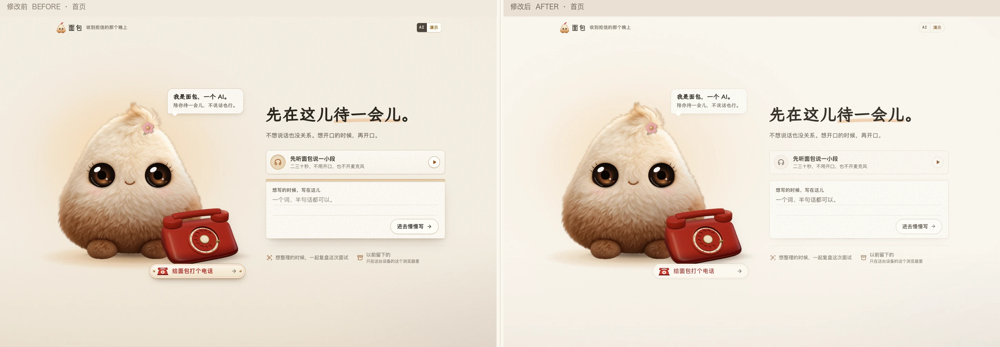](assets/light-refinement/desktop-home-compare.webp) | [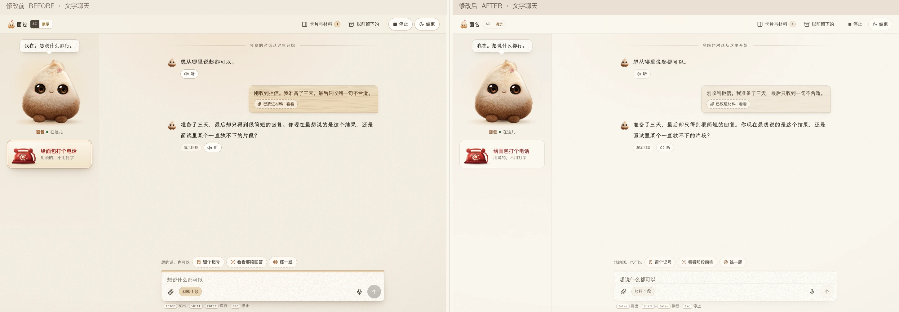](assets/light-refinement/desktop-chat-compare.webp) | [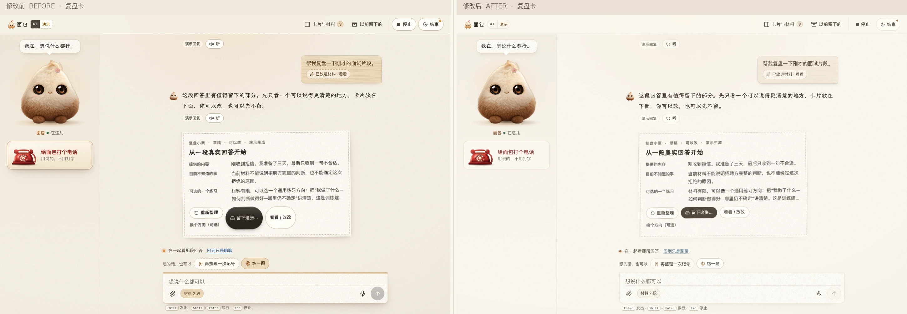](assets/light-refinement/desktop-review-card-compare.webp) |

| 保存弹窗 | 通话中 | 通话错误 / 重试 |
| --- | --- | --- |
| [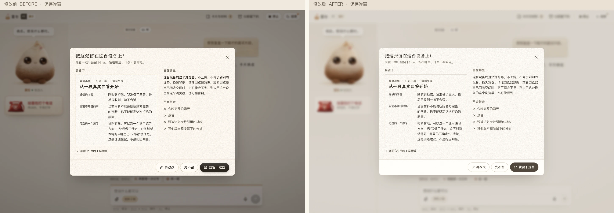](assets/light-refinement/desktop-save-modal-compare.webp) | [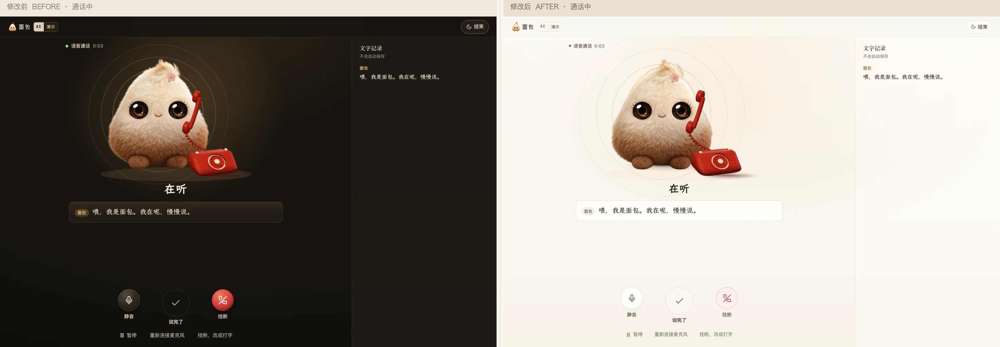](assets/light-refinement/desktop-call-compare.webp) | [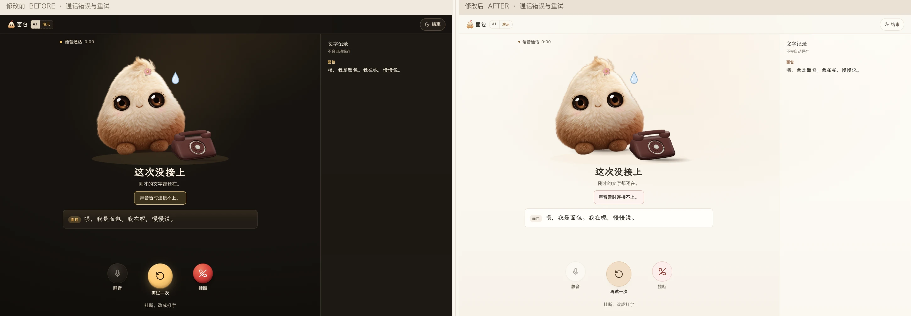](assets/light-refinement/desktop-call-error-compare.webp) |

### 手机

| 首页 | 文字聊天 | 复盘卡 |
| --- | --- | --- |
| [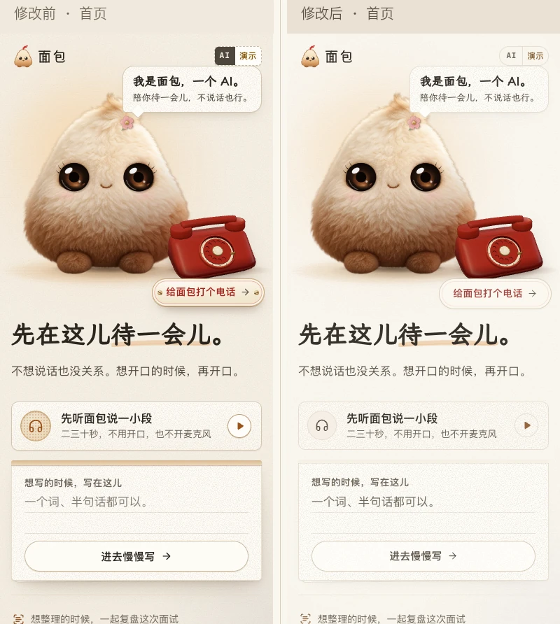](assets/light-refinement/mobile-home-compare.webp) | [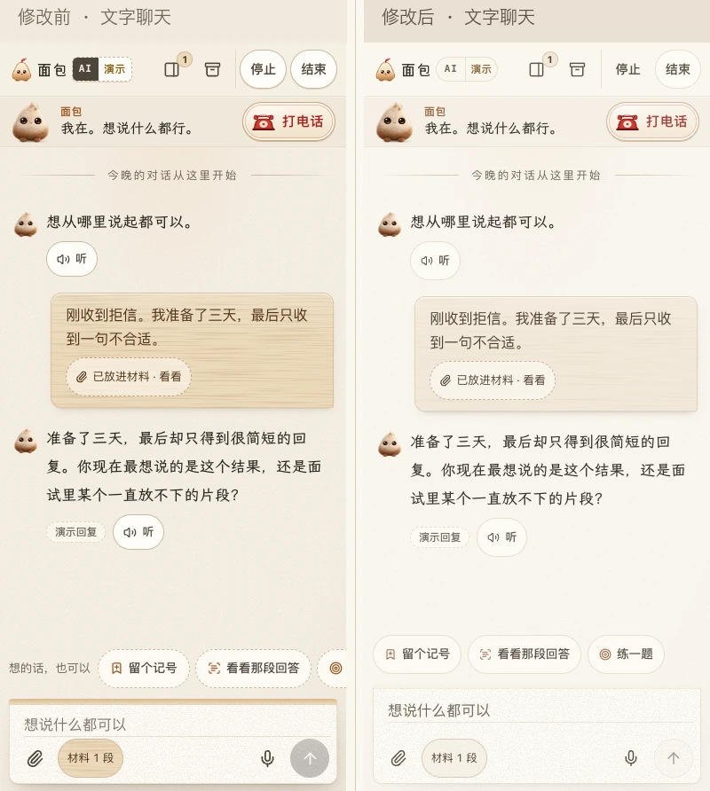](assets/light-refinement/mobile-chat-compare.webp) | [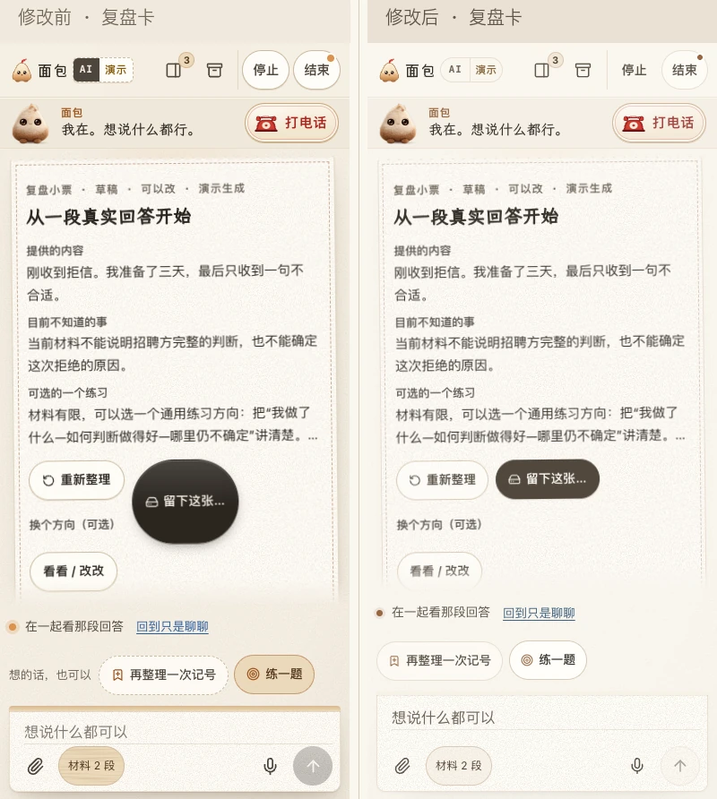](assets/light-refinement/mobile-review-card-compare.webp) |

| 保存弹窗 | 通话中 | 通话错误 / 重试 |
| --- | --- | --- |
| [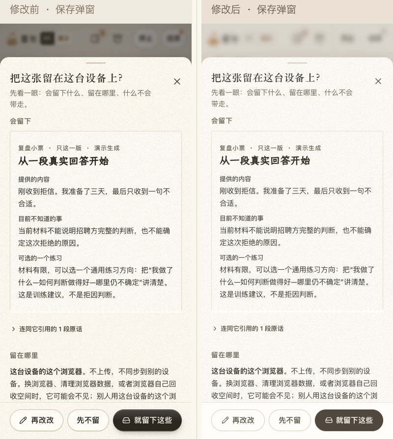](assets/light-refinement/mobile-save-modal-compare.webp) | [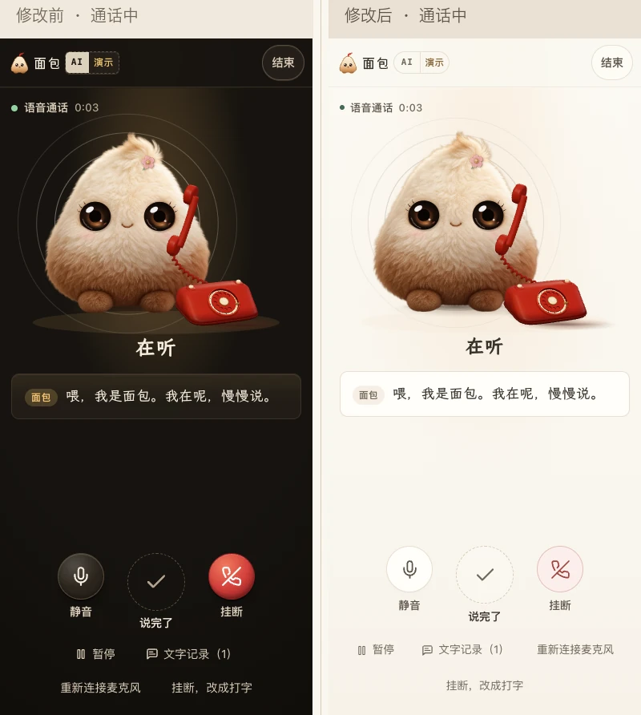](assets/light-refinement/mobile-call-compare.webp) | [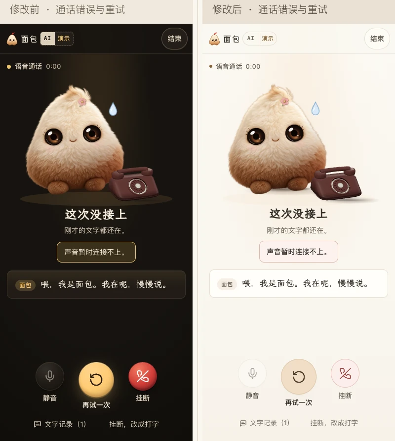](assets/light-refinement/mobile-call-error-compare.webp) |

静音状态：[桌面](assets/light-refinement/desktop-call-muted-compare.webp) · [手机](assets/light-refinement/mobile-call-muted-compare.webp)。
