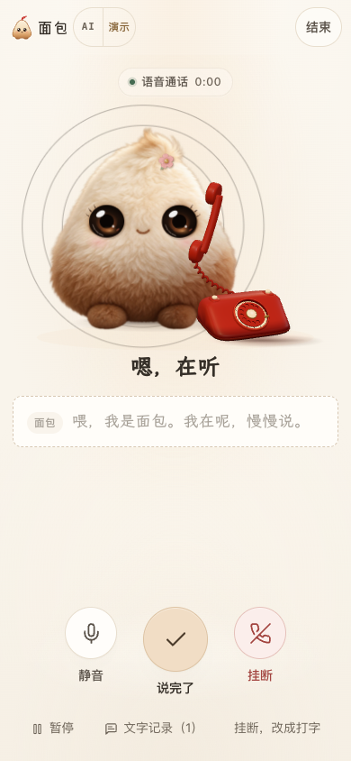
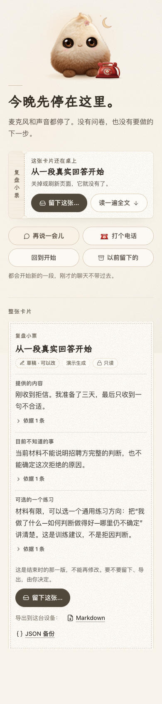

# 前端接力：让操作安静，也让退路清楚

本轮将 DeepSeek 的第二稿接到最新后端，再由官方 Claude Code **Opus 5.5 / high** 继续设计，Codex 负责整合、审查与验证。

## 可以直接感受到的变化

- 首页把“先听”收成一行，便笺成为主要输入面。灯光、文字与按钮沿用浅暖色，保留毛绒面包和红色 3D 电话。
- 手机聊天给面包的第一句话留出完整空间；通话状态与三枚控制键更集中，320px 下仍可操作。
- 连接失败时，顶部状态条按实际高度为页面让位；重新连接不需要刷新，也不清除草稿。
- 结束后先看到保存与离开入口，完整卡片放在下方。未保存时离开仍需确认；取消保存和“再想想”会把键盘焦点带回可操作的位置。

| 手机通话 | 结束后先决定要不要留下 |
| --- | --- |
|  |  |

这些截图来自本地生产构建、Mock 回复与合成媒体，只展示界面，不代表真实模型效果。

## 验证范围

- 类型检查、生产构建通过；**17 个文件、235 项单元/集成测试**通过。
- [PR #21 的完整 CI](https://github.com/ZJUZhiyuCai/bread-companion/actions/runs/41335044446) 通过 **53 条生产浏览器流程**，包含连接恢复、草稿保留、电话打断/取消、来源版本和保存确认。本机额外检查了首屏保存入口、取消后的焦点返回和连接条占位。
- 补充 axe 检查覆盖桌面/手机的结束页、深色结束页、通话说话与暂停，共 **8 个组合，严重/致命违规为 0**。[原始结果](evaluation/frontend-relay-axe.json)
- 手动检查 320px 连接失败及恢复：提示高度约 56px，页面为它留出 57px；特大字号时，两者均为 67px，无横向溢出。恢复后占位清零，草稿保留。390px 结束页的保存与离开入口均在首屏。
- 本轮未改动 `services/`、`server/`、`domain/`、`prompts/` 或 `app/api/`，保留已上线的单连接文字与语音回复链路、开口打断和取消机制。[此前真实延迟测量](call-latency.md)

## 线上复核（2026 年 11 月 2 日）

[主站](https://bread.163-7-7-42.sslip.io/) 已切换到本轮前端，之前的后端提速版本及旧静态资源保留用于回退。本机 3210 同步新版。运行源码的 206 个文件与发布包哈希一致；主站页面引用的 10 个静态资源均返回 200，文字、转写、语音合成与合并回复接口均就绪。[连通性记录](evaluation/frontend-relay-production-readiness.json)

- 切换前，独立预发布实例跑通真实 DeepSeek → MiniMax，依次收到已校验文字、音频和完成事件；重复请求返回 409，错误来源和缺失访客凭据返回 403。
- 切换后，用合成语音注入真实浏览器 AudioWorklet，连接真实线上 API。在 390px 视口的一次完整通话中，说完到启动回复播放为 **5.087 秒**，挂断后媒体轨道全部结束。[原始记录](evaluation/frontend-relay-production-call.json)
- 另一次通话在模型等待阶段直接开口，**455 毫秒**回到倾听；随后一句完成回复，等待 **5.566 秒**，旧回复没有播放。两条 `ERR_ABORTED` 来自测试中的主动打断和挂断，页面没有运行错误。[原始记录](evaluation/frontend-relay-production-interruption.json)

这两个回合用于确认新界面仍能走通真实链路，不是延迟分位数或稳定性承诺。计时包含 VAD、转写、模型、合成、网络与解码，不含硬件出声延迟。

Safari、Firefox 与实体鸿蒙/微信的麦克风、外放和蓝牙仍未在本轮实测。浏览器模拟手机尺寸不能代替真机验证。

## 原稿与整合

DeepSeek 原提交为 `7416009`，基线 `058ad15`；集成时先接到后端已更新的 `39bee96`。Claude 原稿单独保留在 `083083f`，没有用旧前端覆盖后端。Codex 额外修复了通话顶栏的样式覆盖和保存弹窗关闭后的焦点丢失。

[DeepSeek 原设计说明](design-review-relay.md) · [Claude 原交付说明](design-claude-relay.md) · [原稿哈希与接入差异](frontend-relay-provenance.json)

两份设计说明中的测试与未验证范围是各自交付时的记录；最终整合验证以本文及对应提交的 CI 为准。
