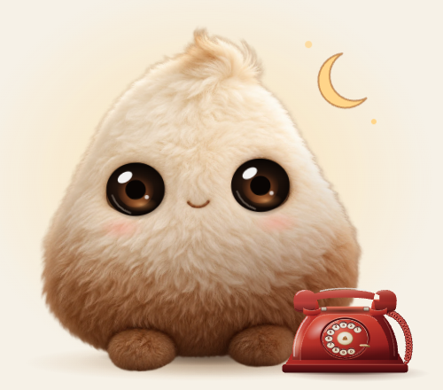
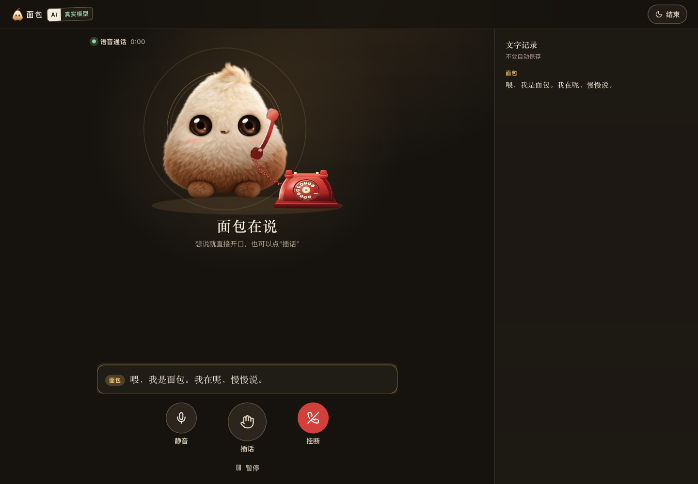

# 0.2.1 · 眼神、电话材质与品牌验收

2026-10-31。范围：移除长期闭眼/半睁的表情，修复静止鼠标下的眼睛与电话抖动，统一伙伴、红色座机与 SVG logo 的光影和配色。Claude 负责设计，Codex 审查、联调与测试；[原稿哈希及接入修改](material-identity-provenance.json) 单独保留。

## 视觉结果

- 眼睛改为深咖啡玻璃珠、大瞳孔和固定窗形高光。暂停、静音、出错、结束均保持完整眼神；通过坐姿、灯光、月亮或小汗珠表达状态。
- 仅保留 190 ms 的短暂眨眼。逐帧暂停检查 0 / 50 / 95 / 150 / 190 ms：眼睛压成一条线再打开，没有旧版长期存在的深色圆框毛片。暂停帧用于检查，不代表产品会停留在半睁状态。
- 电话使用 SVG 分层光影：漆红机身、底座厚度、凹陷转盘、象牙与黄铜、听筒高光、卷线与接触阴影；这是一套模拟体积的矢量插画，不是 WebGL 三维模型。
- [彩色 logo](../public/brand/bread-logo.svg)、[单独图形](../public/brand/bread-mark.svg)、[单色版](../public/brand/bread-logo-mono.svg)、[favicon](../public/favicon.svg) 均为原创纯矢量。检查了 146 / 73 px 字标、32 px 图形、32 / 16 px 图标；XML 校验通过，没有脚本、嵌入位图、外部字体或外部引用。
- 实际浏览器检查：桌面浅色/深色、320/390 px 首页、真实缓存开场播放、暂停、静音、权限拒绝和结束页。截图不含用户聊天或参考照片。

## 抖动：先复现，再修复

| 场景 | 修复前证据 | 修复后检查 |
| --- | --- | --- |
| 首页电话边缘，鼠标不动 | 1.1 秒约 24 次进入/离开；回归测试捕获 32 次进入 | 两侧各观察 1.1 秒，均仅进入 1 次、离开 0 次 |
| 聊天页小电话下边缘 | 1.1 秒 20 次进入、20 次离开 | 进入 1 次、离开 0 次 |
| 鼠标停在电话上，眼神已落定 | 28 次采样中局部虹膜位移范围达 23.22 SVG 单位 | 同样的 28 次、120 ms 间隔采样，两轴位移范围均小于 0.5 SVG 单位 |

首页把命中区域从动画形状中分离。聊天页移除了整个按钮的悬停位移，听筒仍可微抬。眼睛去掉高频随机抖动，目标变化超过死区才转移注视。上述三项已加入浏览器回归测试。

联调还复现了桌面转手机宽度时、媒体查询状态更新前，桌面文字记录挤占通话区域的问题。CSS 在同一断点立即切为单列；原有即时宽度断言现已通过。

## 工程与通话

- `npm run typecheck`：通过。
- `npm test`：9 个文件，155 项通过。
- `BREAD_E2E_PORT=3213 npm run test:e2e`：27 项通过，包含无障碍、保存/导入导出、迟到结果、转写、自然打断、暂停、挂断、权限失败、缓存开场和本轮抖动回归。
- `BREAD_DIST_DIR=.next-material-release npm run build`：通过；在隔离构建目录完成后更新本机 3210 生产服务。
- 生产页面再次检查缓存开场、暂停、静音、挂断、结束及拒绝麦克风权限。使用合成静音输入，未打开物理麦克风；固定开场播放实际本地 MiniMax 音频。
- 没有更换后端、文字路由、温暖闺蜜音色、自然打断逻辑、音频文件或依赖。拨号画面仍跟随真实通话阶段，没有额外等待动画。

## 证据边界

以上浏览器证据来自 macOS Chrome / Chromium。未做新的真人亲和力实验、Safari/Firefox 实机测试、低端机帧率测量、物理麦克风/外放/蓝牙回声测试。本轮没有重新运行付费模型情商或云端延迟评估；[0.2 的语音数据](living-companion-validation.md) 是此前记录，不能当作本次视觉改动带来的性能提升。
