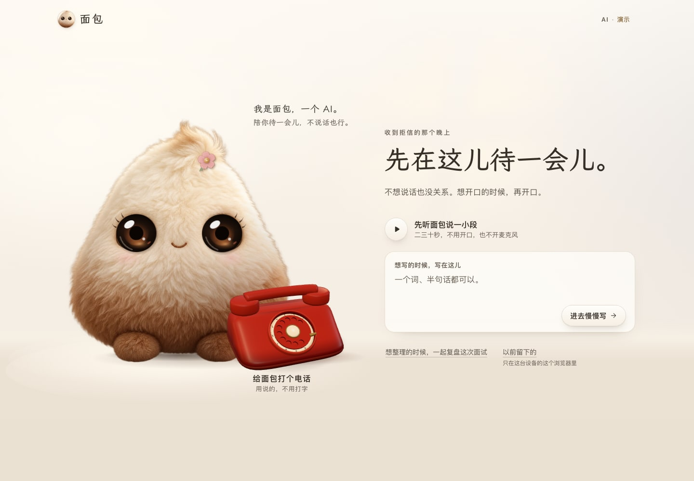
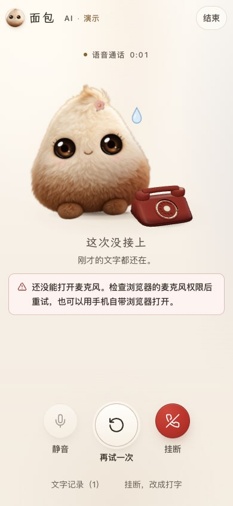

# 一个连贯、安静的空间

2026 年 11 月 2 日，官方 Claude Code **Opus 5.5 / high** 在上一轮诊断后完成两轮设计。Codex 把实际浏览器截图交回同一会话，由 Claude 再调整手机构图、地面明度与通话静帧；最后完成整合和回归。

## 这次改变了什么

面包仍是原来的照片毛绒伙伴，眼睛正常睁开。品牌栏也使用它的头像，移除了风格不同的小卡通；角色台词与标题沿用自托管 Bread Voice，操作文字使用系统字体。背景去掉纸纹、胶带和蜡笔线，让墙面、地面、角色与电话共享一组浅暖色光线。

聊天与结束页的电话入口改为同一 Blender 模型的静帧。通话页准备了听筒落座、拿起两个视角一致的画面：图形尚未就绪时保留静帧，首帧真正画好后才交给 3D。两张新增 WebP 共 **93,062 字节**，只在通话画面挂载时加载，不加入首页或语音启动的等待链路。

手机首页把开场文字移到角色上方；聊天侧栏的底色变轻，通话键采用哑光象牙色，挂断保持红色。恢复、暂停和离开的入口继续跟随真实状态。

| 手机聊天 | 通话失败时的恢复入口 |
| --- | --- |
|  |  |

截图来自本地生产构建，使用 Mock 与权限故障夹具，只展示界面。

## 整合时修复的细节

- **缩放时电话闪空**：Canvas 改变尺寸会清空缓冲区，现在在同一个尺寸回调中重画，避免等到下一帧。
- **听筒突然落回底座**：晚到的 3D 首帧直接采用当前通话姿势，不从初始落座姿势重播拿起动画。
- **加载时出现两只听筒**：静帧之间不叠加淡入淡出。下一姿势尚未解码时先保留已有画面；对应静帧确实失败才使用 SVG。首次进入时，如果静帧和模型都未到达，电话区域会等待素材，麦克风和开场音频继续独立启动。
- **仓库字标依赖访问者字体**：两份独立 SVG 字标使用已有 OFL 字体转曲，保留字体许可，无新增字体下载。

这些是 Codex 的接入修改，与 Claude 原稿分开记录。模型文件、语音状态机、服务端、提示词和模型配置均保持原版。

## 验证

类型检查、生产构建通过；**257 项单元/集成测试、61 条生产浏览器流程**通过。新增五条回归覆盖尺寸重画、晚到首帧、慢静帧不阻塞收音，以及两种静帧分别失败时的降级。前两项均先在旧实现上复现失败，再验证修复。

完整浏览器套件同时覆盖开口打断、挂断取消、连接恢复、来源版本失效、保存确认、320px 控制区及可访问性检查。图形故障测试使用实际软件 WebGL；通话输入使用合成媒体。它们不等同于实体手机测试。

本轮没有改变文字或语音提供商，也不把视觉变化计作延迟改善。真实链路此前的长尾和测量口径见 [语音流式处理记录](call-streaming.md)。Safari、Firefox、鸿蒙微信麦克风与蓝牙尚未在本轮验证。

## 原稿与复现

[Claude 设计计划原稿](design/opus-premium-plan-original.md) · [两轮交付说明原稿](design/opus-premium-implementation-original.md) · [源码哈希与接入差异](premium-frontend-provenance.json) · [电话静帧重建](phone-model.md)

Claude 没有运行本机浏览器或测试；原稿中的效果描述是设计意图。本文的检查结果来自 Codex 实际执行。
