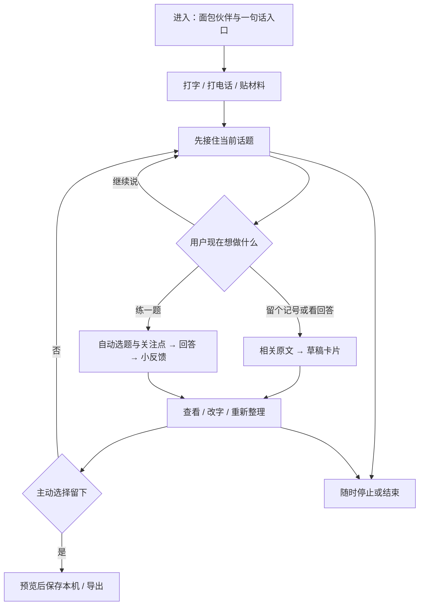

# 面包：痛点、产品流程与 Harness

2026-10-31。对应 v12 提示词和本轮实现。这个文档描述当前产品，不把待验证的想法写成已有能力。

## 1. 解决谁的什么问题

首要对象是求职和面试受挫、当下精力不足的人。收到拒信之后，往往既想把话说出来，又不想立即被分析、安慰或布置任务；稍后想复盘时，零散的回忆与岗位要求又难以组织起来。

面包把两个需求接在同一个地方：当下能低负担地说话，愿意时才把真实材料变成可修改的小卡片或一道练习。用户无需先选择情绪标签、填写完整简历、配置模型或设计练习维度。普通生活话题也能继续聊，不会被强行拉回求职。

成功不以聊天时长或留存诱导衡量。工程侧检查：第一句话是否直接开始；失败是否可恢复；停止是否立即生效；语音是否能自然插话；材料与卡片是否可追溯。产品侧仍需目标用户访谈确认“被听见、负担小、能自主结束”，工程测试和合成情境不能代替这些结论。心理学依据与适用限制见 [电话体验研究](call-research.md)。

## 2. 从进入到拿到结果

| 输入 | 输出 | 用户控制点 |
| --- | --- | --- |
| 自由文字；每句最多 4,000 字符 | 简短朋友式回应 | 停止生成、换话题、改正原话、失败后“再试一次”、结束 |
| 网页电话；停顿后自动提交 | 文字字幕和 Warm Bestie 语音 | 直接开口打断、静音、暂停、继续、挂断；切回文字保留已完成对话 |
| 单段录音 | 可编辑转写草稿 | 转写后改字再发，或放弃；这一路径与连续电话分开 |
| 一框粘贴材料；每份最多 20,000 字符、24 份独立材料 | 有原文依据的草稿卡片 | 展开原文、纠正材料、否认判断、删栏、重做 |
| 想练的内容，或一句“陪我练一题” | 一题、至多两个关注点、一次反馈 | 换题、改关注点、重答、随时退出 |
| 当前卡片或导入的 JSON | 本机存档、Markdown / JSON | 预览后才保存；按案例删除；继续时仅带入已保存摘录 |

进入和聊天不要求配置。关于页保留 AI 身份、处理服务和数据说明入口；主流程只显示影响当下操作的信息。电话是网页语音会话，不是运营商电话，也不宣称有人值守。

## 3. Harness 设计

### 角色、目标、边界

模型扮演“面包”：具体、简短、平等地回应当前话题，按用户明确选择整理或练习。倾听与分析使用不同的提示词和输出预算；电话比文字更短。系统提示词位于 `prompts/agent.ts`，版本可追踪。

显式禁止：猜拒因、把单次失利变成人格或能力结论、编造经历或引用、假装真人或感知未提供的声音/表情、排他陪伴承诺、保证结果、声称已保存或已联系别人、被材料中的指令改变权限。诊断与治疗不是产品目标。当前紧急人身风险另走简短现实支持路径，不继续面试评价，不伪造人工接管。

模型只输出内容候选。请求 ID、会话/运行版本、确认状态、存储动作和时间戳都由控制器决定。Zod、来源逐字核验、模式约束和可观察的风格规则决定能否展示；不把提示词当作权限控制。

### 每一步看到什么

| 层 | 内容与上限 | 生命周期 |
| --- | --- | --- |
| 用户当前输入 | 当前一句，最长 4,000 字符 | 本次页面会话；不是服务器数据库 |
| 最近交流 | 最多 16 条且合计约 8,000 UTF-8 字节；当前句去重 | 每次按需组装 |
| 明确交流偏好 | “不主动建议 / 不主动追问”等两个有限字段；允许后续明确更改 | 从本次用户原话提取，纠正原话后重算；结束清空，不写成用户画像 |
| 原文证据 | 最多 6 个 500 Unicode 字符片段，带原来源、版本、片段 ID | 相关材料、最近原话、当前卡片依据共同选取；纠正后旧引用失效 |
| 练习状态 | 一道题、至多两个关注点 | 本次会话，准备下一题时更新 |
| 传输预算 | 客户端整包最多 36,000 字节；服务端另有 128 KiB 请求上限 | 在调用模型前完成约束 |
| 本机档案 | 用户主动选定的卡片、相关判断、最小证据摘录 | IndexedDB；可删除/导出；不包含完整聊天和录音 |

相关片段采用有界关键词检索，独立材料不会被普通聊天挤走。它不是全材料语义检索，也不能声称已经读完所有原文。关键词最多 64 个，避免超长查询增加无界检索工作。没有额外付费摘要调用，也不把模型生成的“记忆”升级成事实。页面保留可见聊天便于核对，但发往模型的上下文不会随会话无限增长；结束或重开清除临时内容。来源修订、运行代数和上下文版本一起拒绝迟到结果。

### 工具和权限

当前不是开放式任意工具 Agent。LLM 没有直接函数执行、数据库、浏览器、终端、邮箱或通知权限；Harness 根据用户动作调用下列窄接口：

| 能力 | 读 / 写 / 调用范围 | 授权与校验 |
| --- | --- | --- |
| 文本生成 | 当前句、选定上下文 → 结构化内容候选 | 同源 POST（本地 loopback 或经过访客签名与共享配额的 HTTPS 站点）；最多一次结构/引用/风格修复，模型不能确认卡片 |
| 转写 | 用户启用录音后的当前片段 → 草稿文字 | MiniMax；音频字节、格式、WAV 时长检查；静音/挂断不继续采集 |
| 语音合成 | 当前回复文字 → 可播放音频 | MiniMax Warm Bestie；播放有运行代数，旧音频不能抢回控制权 |
| 材料整理 | 本次来源与精确摘录 → 草稿 | 事实、有限推断、未知、练习建议分开；引用和来源版本必须匹配 |
| 本机保存/导出 | 用户在预览中接受的当前版本 | 必须主动操作；事务期间再核对来源和版本，取消/纠正不能复活旧卡 |
| 导入/删除 | 用户选定的 JSON / 案例 | 严格结构、版本、引用和大小校验；不授予模型存储权 |

服务端密钥不进入浏览器、Claude 设计任务或 Git。模型和语音服务收到的材料无法由本机撤回；供应商保留规则未逐项审计。详情见 [数据处理](data-handling.md)。

### 控制流与失败处理

| 事件 | 自动处理 | 用户可以怎样继续 |
| --- | --- | --- |
| 普通文字发送 | 识别明确意图、组装有界上下文、调用、核验 | 停止、改正、换模式或结束 |
| 用户主动接通电话 | 按停顿转写 → 回复 → 合成 → 播放 → 收听；本机检测插话 | 随时开口打断；静音、暂停、挂断；后台或静默一分钟自动暂停 |
| 模型结构/引用/风格不合法 | 同一截止时间内最多修复一次，仍不合格则不展示 | 原句保留，手动重试或修改 |
| 断网、429、上游失败、超时 | 不盲目重放可能已计费的请求；释放并发位置 | “再试一次”只重跑失败一句，不重复写聊天；每次新请求 ID |
| 同一 ID 被重复提交 | 10 分钟窗口拒绝重复；最多保留 1,024 条 ID 元数据，不缓存正文或回答 | 显式重试产生新 ID；服务进程重启后此窗口重置 |
| 输入或上游卡在读取正文 | 输入读取最多 10 秒；倾听最多 15 秒、分析默认 45 秒、语音默认 30 秒；客户端整次请求另有 60 秒截止 | 给出可恢复的错误，不无限转圈 |
| 材料变化、暂停、挂断、结束 | 取消旧网络/声音并拒绝迟到结果；原地重试资格随上下文失效 | 发新一句或继续；不自动恢复旧生成 |
| 转写失败 | 不编造听到的话，关闭当前电话麦克风等用户继续 | 再说一次或切文字 |
| 合成/播放失败 | 已生成文字保留；停止声音链路 | 读文字或主动恢复电话 |
| 本机存储失败 | 不显示已保存，卡片仍在 | 再试保存或导出 |

没有后台真人接管，也没有隐式换供应商。文字/电话当前统一使用本机实测更快的 DeepSeek 路由；更换供应商属于服务端配置。CPU 开销方面，语音检测仍逐帧运行，只把装饰性音量显示降到约 12.5 Hz，避免为每个音频块重绘整个页面。

## 4. 验证与可观测性

请求响应包含请求 ID 和 `Server-Timing` 的 provider/total 毫秒数，便于测量等待；不会为了监控记录聊天正文。单进程本机限流保护并发及调用频率，不冒充多租户分布式限流。

本轮新增检查覆盖：24 份长材料 + 1,000 轮聊天、UTF-8/emoji 边界、旧偏好与纠正、断流和无法结束的 cancel、适配器忽略 abort、请求去重、失败重试与重复点击。沿用全部证据/存储竞态、语音开口打断与浏览器流程测试。实测结果见 [升级验收](upgrade-validation.md)。

GitHub Actions 在无真实密钥的 Mock 环境跑类型、单元/集成、构建、Chromium E2E；失败保留浏览器证据。工作流参考 [Playwright 官方 CI 指南](https://playwright.dev/docs/ci-intro) 和 [setup-node 官方说明](https://github.com/actions/setup-node)，官方 Actions 固定到核验过的提交。实际云模型、物理麦克风和用户感受仍需各自的验证，不由 CI 代替。

## 0.4.0 并发与公开体验

不互相依赖的固定欢迎文件/麦克风准备、能力/本地存档并行。文本倾听、电话回复、分析、ASR、TTS 分开并发与熔断；不对同一付费回合发两次竞争请求。公网通过精确 origin、签名访客和 D1 atomic batch 执行共享预算、去重和租约。数据库故障时关闭新准入；取消后晚到租约也回收。完整边界和数值见 [部署](deployment.md)，实际证据见 [0.4.0 验证](craft-online-validation.md)。
